# LNGUI benchmark — UML

Diagrams of the benchmark and its experiment harness, as built on
`conform-to-chapter4`. Equation and section numbers refer to Chapter 4 of the
proposal. GitHub renders the Mermaid blocks directly.

The diagrams fall into four groups:

1. **Structure**: components and deployment.
2. **Design (classes)**: the formal state model, commands and records,
   relations and cases, the experiment runner, generation, and the API layer.
3. **Behaviour (sequences)**: one chat turn, the command handler, one sweep trial.
4. **Behaviour (activities and states)**: the sweep loop, the relation check,
   the trial lifecycle, and case generation.

---

## 1. Structure

### 1.1 Components

Every arrow is an import or a call. The `shared/` modules are pure. `M` (the
mediator) is the only impure stage. There is one sweep engine,
`utils/sweep.ts`, and two front ends drive it: the Experiments page in the
browser and `scripts/sweep.ts` in Node.

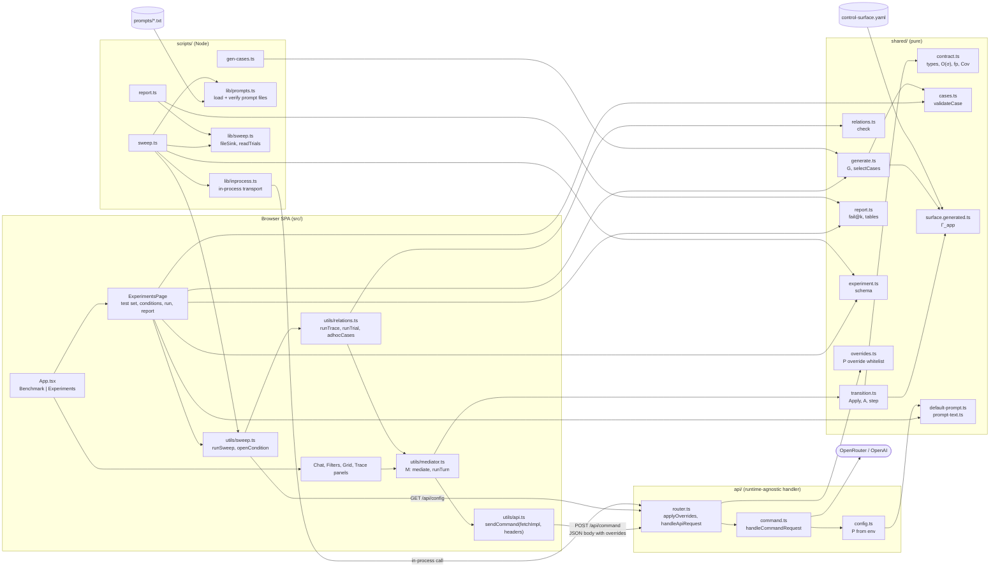

### 1.2 Deployment

One router serves three hosts. The engine runs in the browser (through Vite and
Express, or the Worker) or in Node (handler in-process). Either way each
condition reaches the router as request overrides.

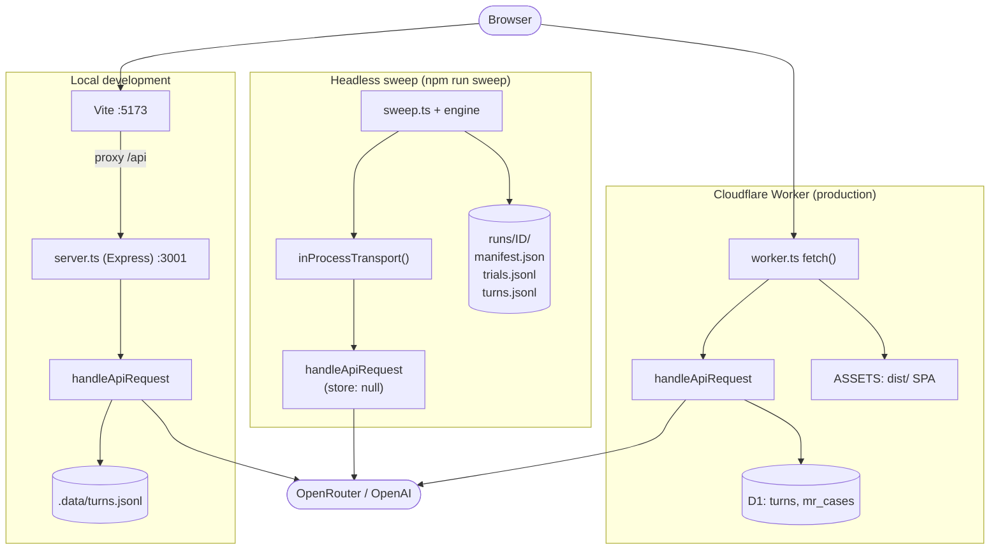

---

## 2. Design: classes

### 2.1 Formal state model σ = ⟨V, H, P, D⟩

`O(σ) = ⟨V, D⟩` is the only thing a relation compares. `H` and `P` are
recorded for replay and attribution and never enter a verdict.

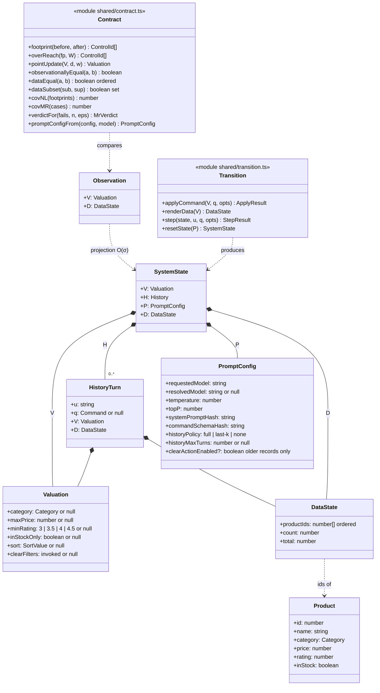

### 2.2 Commands, provenance and records

`q` is the boundary between the mediator and the application. A `TurnRecord`
is the replay unit (§4.17); its `meta` pairs every result with the model and
parameters that produced it.

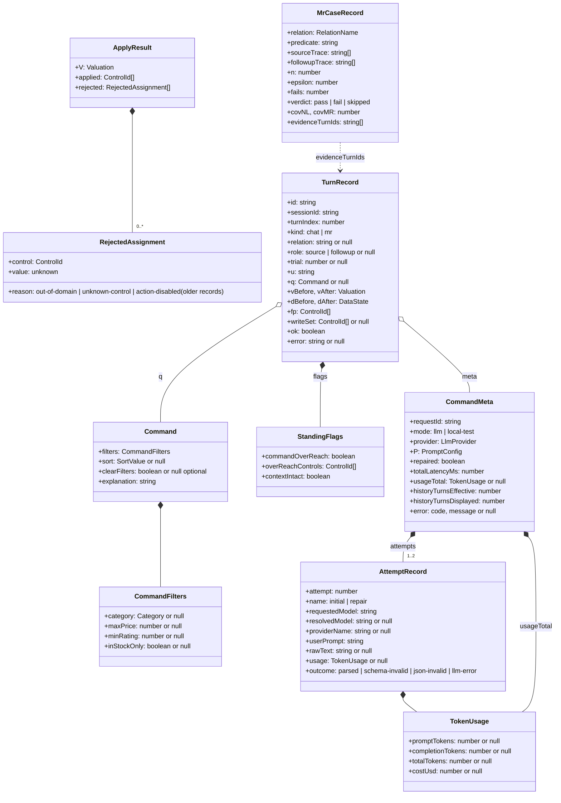

### 2.3 Relations and frozen cases

`MrInstance` is what `check` needs. `MrCase` adds what the analysis needs: a
stable id, a semantic group for clustering, strata and provenance. Every
`MrCase` is usable wherever an `MrInstance` is.

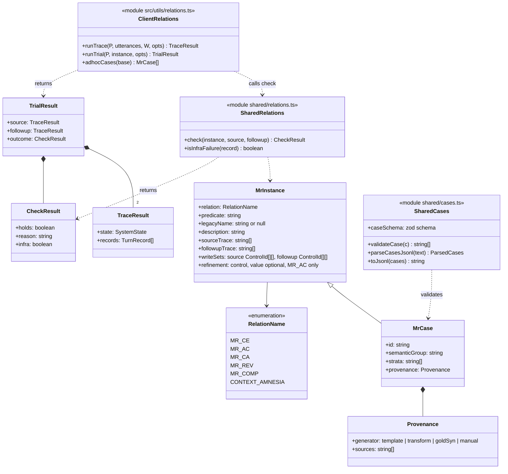

The precondition each relation enforces in `validateCase`:

| Relation | Source trace | Follow-up trace | Label check |
| --- | --- | --- | --- |
| `MR_CE` | `[u₁]` | `[u₂]` | `W(u₁) = W(u₂)`, `u₁ ≠ u₂` |
| `MR_AC` | `[u_b]` | `[u_b ⊕ δ]` | `d ∈ C_con`, `d ∉ W(u_b)`, `w ∈ Dom(d)`, follow-up `W = W(u_b) ∪ {d}` |
| `MR_CA` | `[u₁, u₂]` | `[u₂, u₁]` | `W(u₁) ∩ W(u₂) = ∅`, both non-empty |
| `MR_REV` | `[]` (σ₀) | `[u_f, u_i]` | `W(u_f) ⊆ C_rev`, `W(u_i) = W(u_f)` |
| `MR_COMP` | `[u₁ … uₙ]`, n ≥ 2 | `[u_s]` | `W(u_s) = ⋃ W(uᵢ)` |
| `CONTEXT_AMNESIA` | `[u₁]` | `[u₁, f₁ … fₖ]` | `W(u₁) ∩ ⋃ W(fᵢ) = ∅` |

### 2.4 Experiment runner and report

One engine. A front end supplies a `Transport` and a `TrialSink`. A
condition's P travels as `Overrides`.

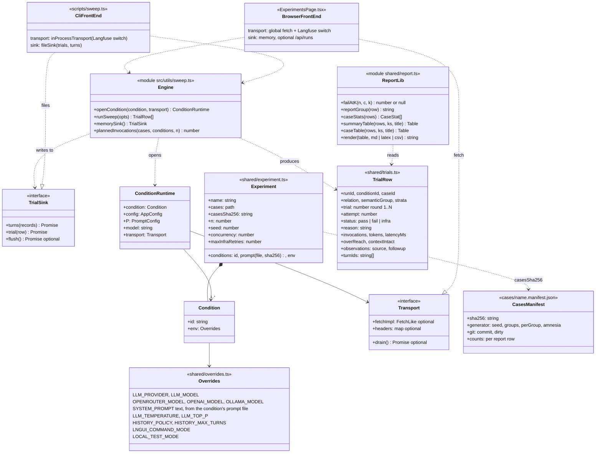

### 2.5 Generation from Γ_app

`control-surface.yaml` is compiled into `surface.generated.ts`. The generator
fills templates and clauses from it, validates every candidate, and selects a
seeded, stratified test set. [case-generation.md](case-generation.md) compares it
with the proposal and justifies its two deviations.

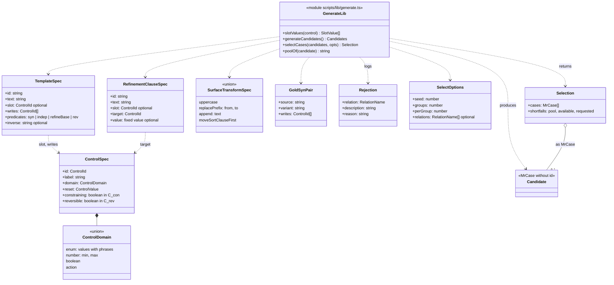

### 2.6 API layer

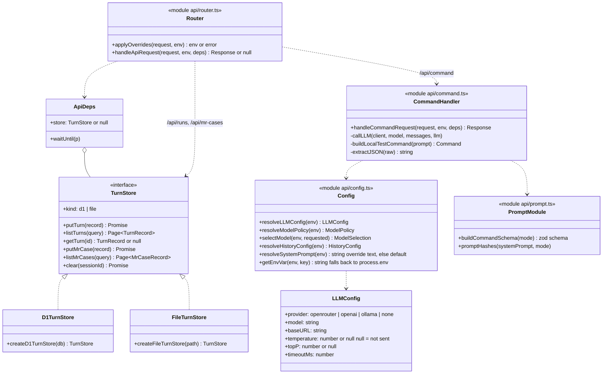

---

## 3. Behaviour: sequences

### 3.1 One chat turn in the browser (Eq. 4.7)

`u --M--> q --Apply--> V′ --A--> D′`. Everything after `q` is deterministic.

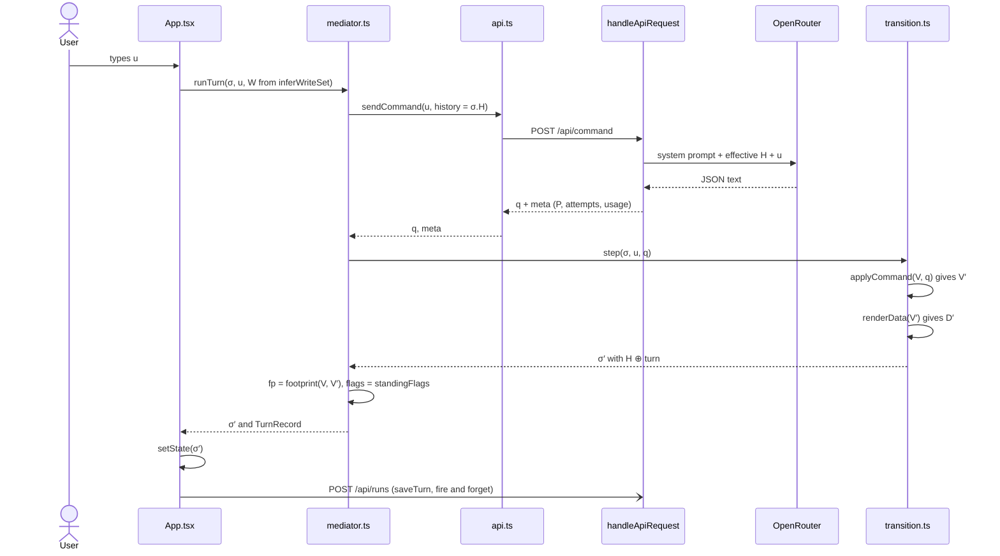

### 3.2 Command handler: attempts and repair

The handler records one or two attempts. A repair retries once without
history when the first reply is not valid JSON or fails the schema.

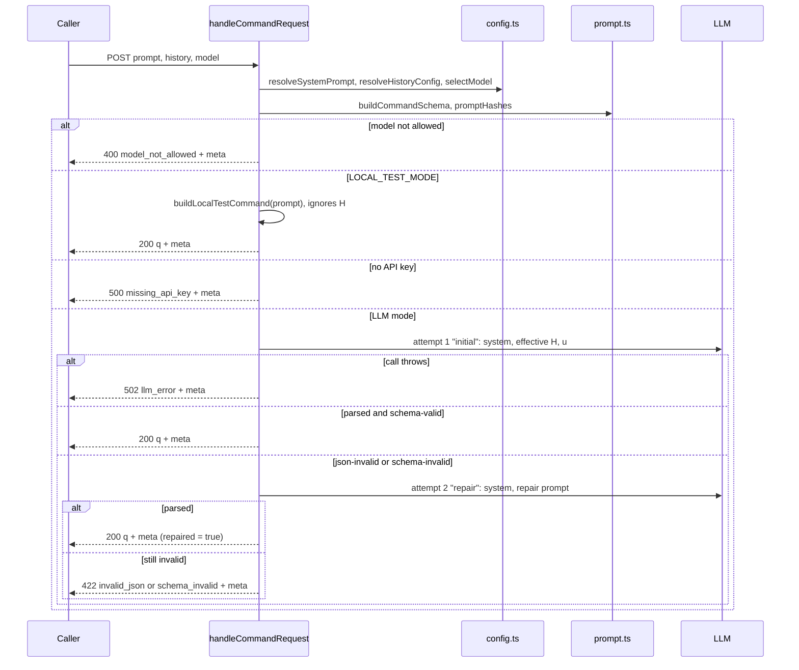

### 3.3 One sweep trial, in-process

The same sequence runs from both front ends. Only the transport `F` differs:
browser `fetch` over HTTP, or the handler called in-process. The router
applies the condition's overrides before any handler resolves P.

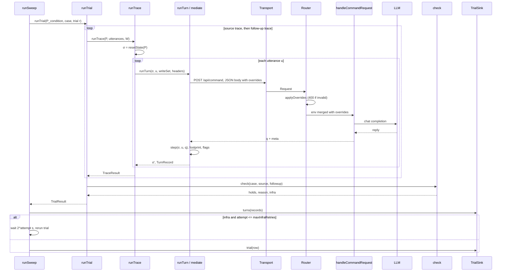

---

## 4. Behaviour: activities and states

### 4.1 The sweep loop

Shown for the CLI. The Experiments page runs the same checks before it starts
and the same loop afterwards.

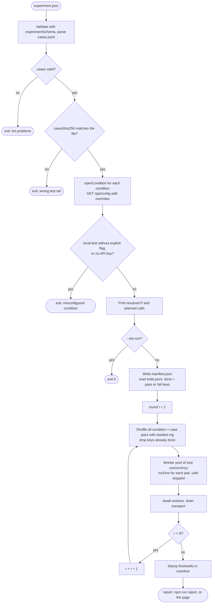

### 4.2 The relation check

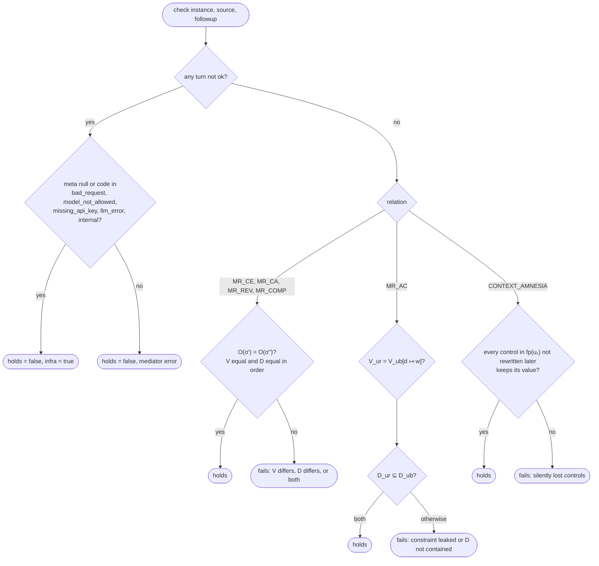

### 4.3 Trial lifecycle

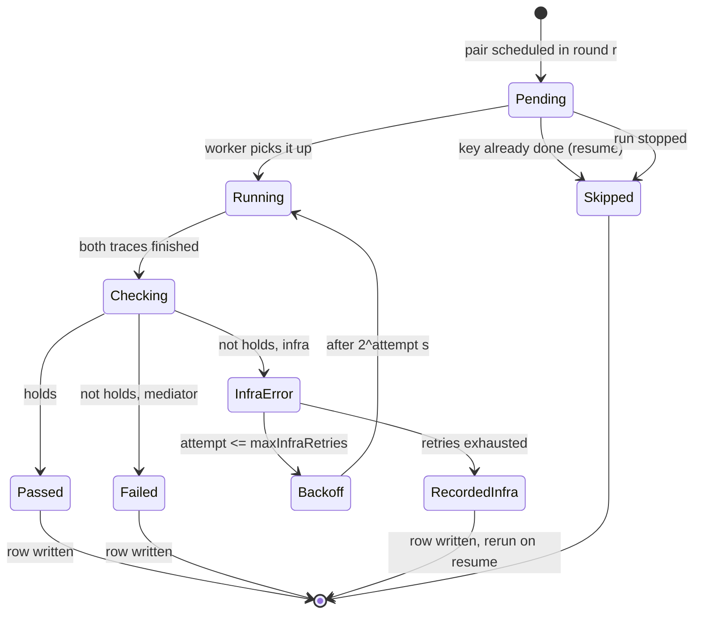

### 4.4 Case generation

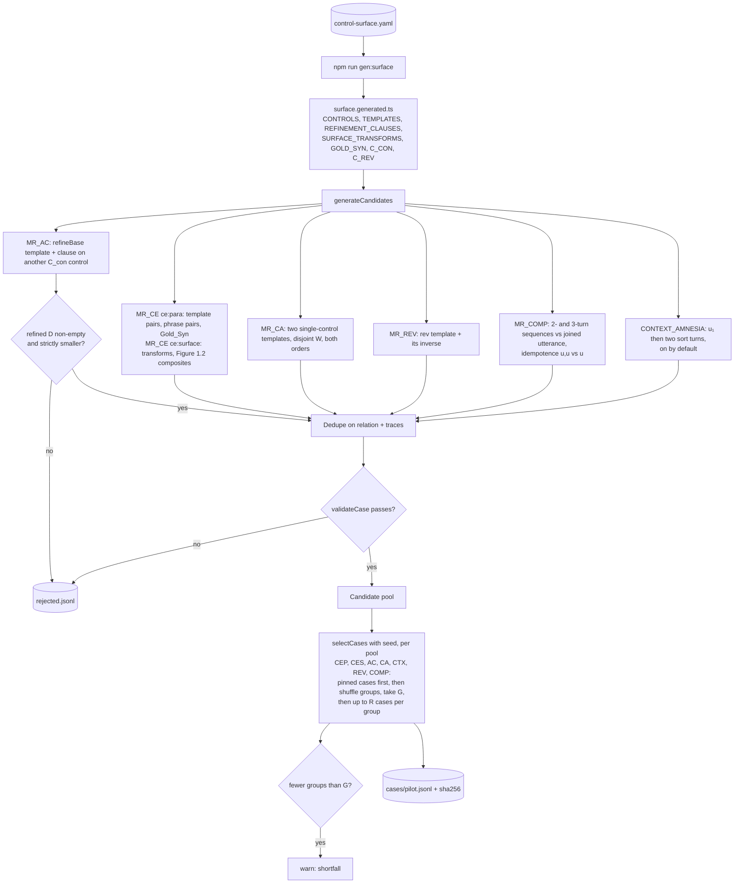

### 4.5 End-to-end experiment pipeline

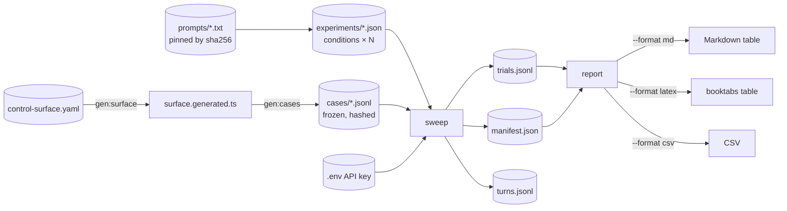
